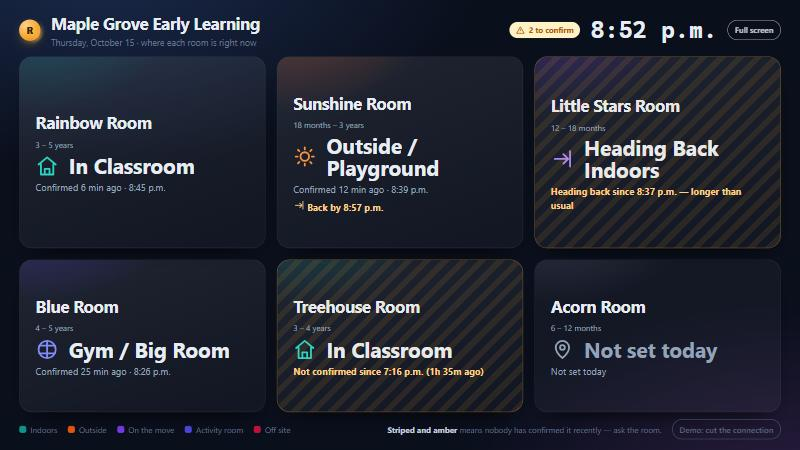
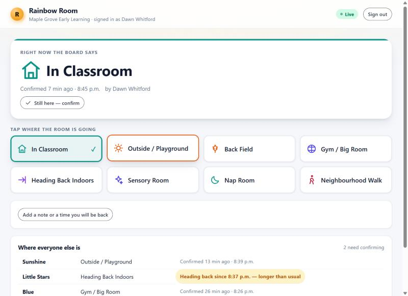
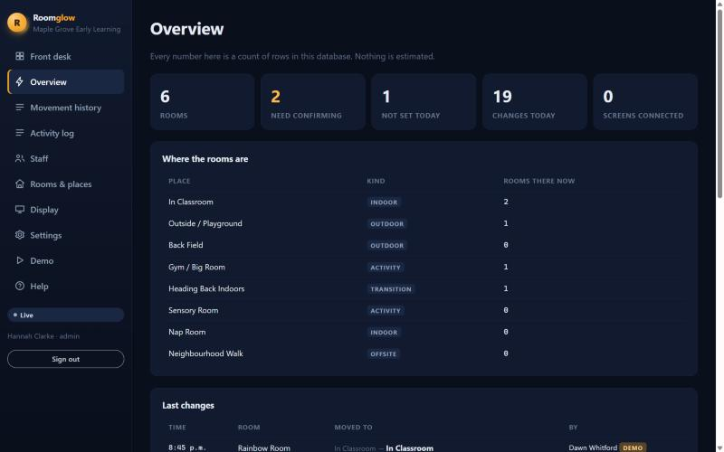
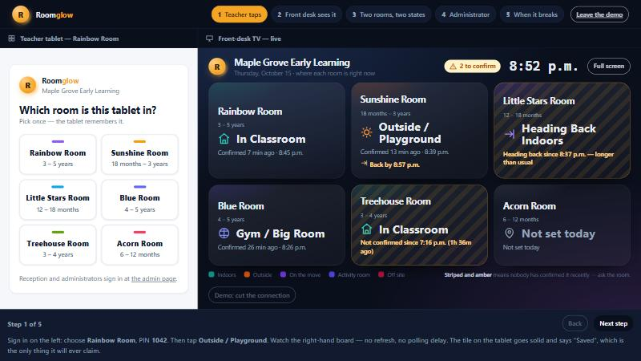
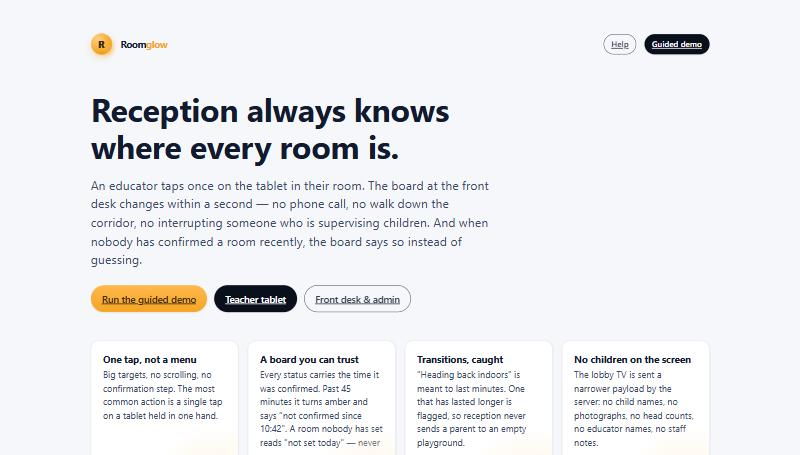

# Roomglow — a live classroom whereabouts board

**The problem:** at pickup time a parent arrives at the front desk and asks where their
child's room is. Reception phones the room, or walks the corridor, or interrupts an
educator who is supervising children — twenty to forty times a day, at exactly the moment
supervision matters most.

**The product:** an educator taps once on the tablet in their room. The board at reception
changes within a second. And when nobody has confirmed a room recently, the board says so
instead of showing a stale location as though it were current.

> Case study. The working product is in a private repository; this page shows what was
> built, how, and what it cost. Selected source is in [`code/`](code) — the parts worth
> reading, not the whole system.

---

## The front-desk screen



Read from four metres by someone already talking to a parent. Six rooms, five different
states, all legible at a glance:

| What you see | What it means |
|---|---|
| **In Classroom** · "Confirmed 6 min ago · 8:45 p.m." | An educator said so, recently |
| **Outside / Playground** · "Back by 8:57 p.m." | With an expected return time |
| **Heading Back Indoors** · amber stripes, *"longer than usual"* | A transition open for 14 minutes against a 10-minute threshold — reception will not send a parent to an empty playground |
| **In Classroom** · amber, *"Not confirmed since 7:16 p.m. (1h 35m ago)"* | Probably still true. Not recently confirmed, and it says so |
| **Not set today** · grey | Nobody has set it. **The board never guesses** — there is no default "In Classroom" |

What is deliberately **not** on that screen: any child's name, any photograph, any head
count, any educator's name, any note staff have typed. The server builds a separate,
narrower payload for the lobby display — the fields are not hidden by the page, they are
never sent to it. An automated test asserts this on both the HTTP response and the live
event stream.

## The teacher's tablet



One tap. No menu, no confirmation step, no scrolling. Targets are 72px and the most
frequent action is reachable without looking. Sign-in is a 4-digit PIN on a keypad,
because the alternative is typing an email address while holding a child.

The sign-in screen lists **rooms, never staff names** — no personal information leaves the
server before somebody has proved who they are.

If a tap cannot reach the server, the tablet says **"not saved"** and offers a retry.
Nothing is queued silently; nothing claims to have saved when it has not.

## Reception and administration



Three roles, enforced on the server and not by hiding buttons:

- **Educator** — may change only the rooms assigned to them.
- **Reception** — sees the staff board and can **ask a room to confirm**, which puts a
  prompt on that room's tablet. Reception *cannot set a location*: the front desk cannot
  see the playground, so letting it record one would turn a guess into a record.
- **Administrator** — can override any room, and an override is recorded as an override,
  with a name and a time, in an append-only history.

## The guided demo



The teacher's tablet and the front-desk TV, side by side in one window, each holding its
own live connection to the server. A tap on the left travels to the server and comes back
to the right. It is not a mock-up and it is not pre-recorded — which, for a product whose
entire value is "the board is true", is the only honest way to demonstrate it.



---

## How it is built

| Layer | Choice |
|---|---|
| Runtime | Node 24, TypeScript executed directly via type stripping — **no build step** |
| Dependencies | **Zero at runtime.** `npm ci` installs nothing that ships to production |
| Storage | `node:sqlite` from the standard library, WAL, one writer |
| Live updates | Server-Sent Events, in-process fan-out, **two audiences and two payloads** |
| Auth | scrypt from `node:crypto`; session tokens stored only as their SHA-256 |
| Front end | Hand-written CSS and vanilla ES modules, ~30KB of JavaScript, installable as a PWA |
| Hosting | One 256MB machine: **$2.19/month**, scale-to-zero for the demo |

Zero runtime dependencies is a deliberate decision rather than a flourish: on a system
installed in a childcare centre, there is no transitive supply chain to audit, and nothing
to patch at 2am because a package three levels down was compromised.

### Why not the obvious alternatives

- **Not a native app.** Nothing it does needs one. A PWA installs to the tablet's home
  screen with no app store, no $99/year, no device management, no second codebase.
- **Not a serverless platform.** The product is a process holding live connections with a
  local database. The popular free tier is also *non-commercial use only* by its own
  terms, which a client demo is not.
- **Not a managed Postgres.** Six rooms and a few hundred writes a day is a 200KB file.
  A database service would have added a monthly bill to replace it.
- **Not an all-in-one childcare suite.** Those exist, are priced per child, and quote
  only. This answers one question, for a flat $2.19 a month.

### The real-time design

```
teacher tablet                    server (one process)                lobby TV
─────────────                     ────────────────────                ────────
PATCH /rooms/:id/status  ──▶  validate · authorise · write
                              append to history · bump version
                         ◀──  200 { state }
                                      │
                                 hub.publish()
                              ┌───────┴────────┐
                              ▼                ▼
                       staff payload      kiosk payload
                   (notes, who, devices)  (no names, no notes)
```

Every client is sent a **full snapshot on connect**, then deltas. The board is two
kilobytes, so replaying a missed-event log would be more machinery for a weaker guarantee:
after a reconnect the screen is simply correct, whatever it missed.

## Testing

**79 automated tests, all driving the real HTTP server** against a throwaway database —
no mocks. The reason is a scar from an earlier project: a `SELECT *` once shipped password
hashes to a browser, invisible to the type system and obvious in a response body.

Three real bugs the tests caught during the build:

1. **Every administrator override returned a spurious conflict.** `version: null` means
   "no version check"; the code wrote `Number(null)`, which is `0`, a version no room has
   ever had.
2. **Four typos could have locked out an entire centre.** The sign-in throttle applied
   exponential backoff per *address*, and a building behind one router is one address.
   Backoff now belongs to the identity; the address only gets a blunt sweep cap.
3. **The help search presented a guess as an answer.** A question about billing matched
   the privacy topic on the word "parents" and was captioned "answered from the guide".
   The matching was narrowed and the wording now hedges.

A fourth was caught by the browser rather than a test: the Content-Security-Policy forbids
inline `style` attributes, and several had been written into the markup.

**Live, against the deployed server:** a teacher's tap reached the front-desk stream in
**669ms**, with the staff note and the educator's name confirmed absent from the wire.

## Privacy, deliberately

The centre is in Alberta, so **PIPA** governs the staff information this holds and the
*Early Learning and Child Care Act* governs the programme.

- The system holds **no child records at all**. Not a name, not a photo, not a count.
- The only personal information is staff names, roles, and which status changes they made
  — kept so a safety-relevant record has an accountable author.
- The lobby screen's payload is built separately and tested separately.
- The service worker caches the shell so a tablet still opens offline, and **never caches
  an API response**, because a cached board is a lie that looks exactly like a live one.

Not certified compliant with anything, and said so in writing to the client rather than
implied otherwise.

## What it costs

| | |
|---|---|
| Hosting, always on | **$2.19/month** (256MB machine) |
| Database storage | $0.15/month |
| TLS, backups, monitoring | $0 |
| **Total** | **≈ $2.36/month** |
| Subscription to the software | **None.** No monthly licence, no per-child fee, no seats |

For contrast, childcare suites that include a room view are priced per child and quote
only; independent estimates put them at $2–4 per child per month. They do far more than
this does — the comparison is about the board, not the suite.

## The code in this repository

Selected modules, as they are in the private repository. Enough to judge how it is built;
not a system anyone can run.

| File | What it shows |
|---|---|
| [`code/core/rooms.ts`](code/core/rooms.ts) | The trust model: freshness, overdue transitions, optimistic concurrency, repeated-tap detection, and the two payload shapes |
| [`code/core/events.ts`](code/core/events.ts) | The SSE hub: one publish, two audiences, heartbeats a client can actually observe |
| [`code/core/auth.ts`](code/core/auth.ts) | scrypt credentials, hashed session tokens, named capabilities, PIN sign-in scoped to a room |
| [`code/core/ratelimit.ts`](code/core/ratelimit.ts) | Two-axis throttling, and the comment explaining why one axis nearly locked out a building |
| [`code/tests/access.test.ts`](code/tests/access.test.ts) | The test that asserts a child's name or a staff note cannot reach the lobby screen |

Not included: the HTTP layer, the routes, the database schema, the seed data, the front
end, and the deployment configuration.

---

Built by **Abdullah Rathore**. Available for similar work — small operational software
that is honest about what it knows.
